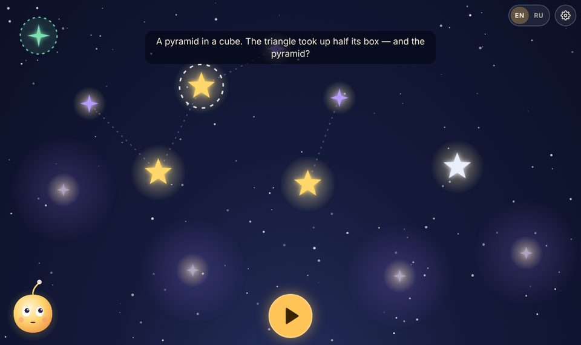
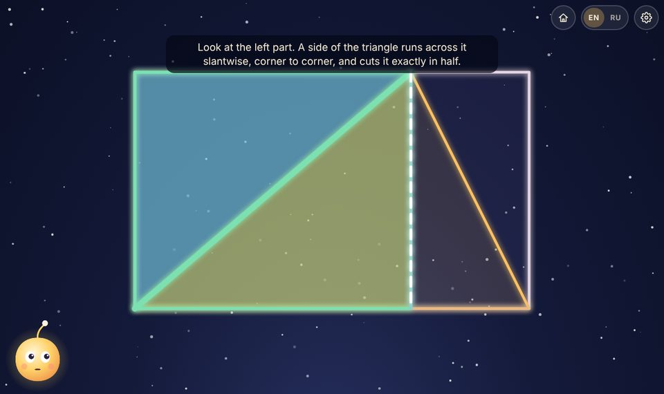
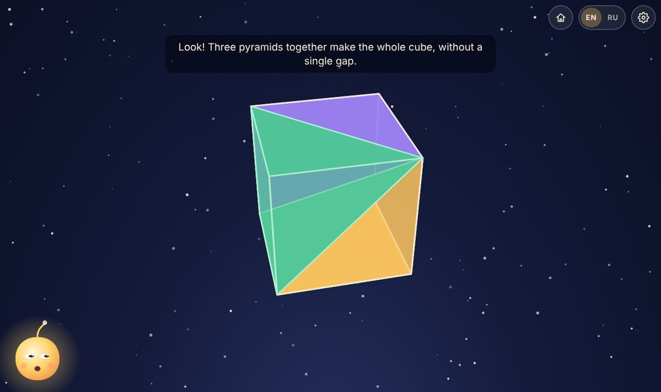
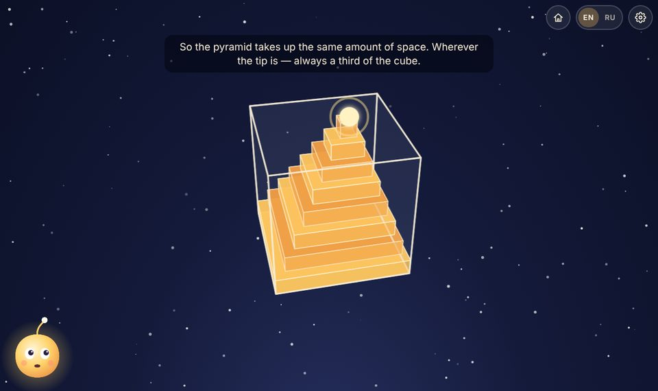
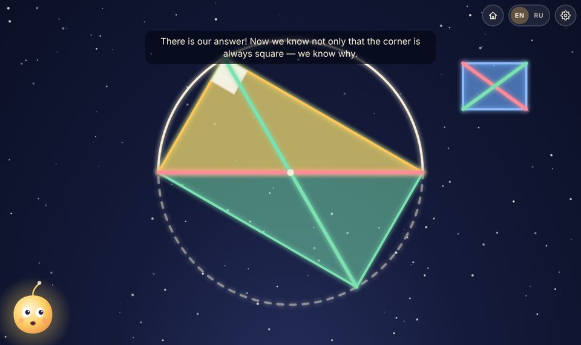
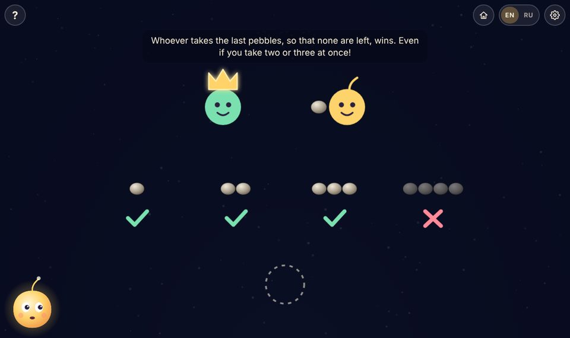
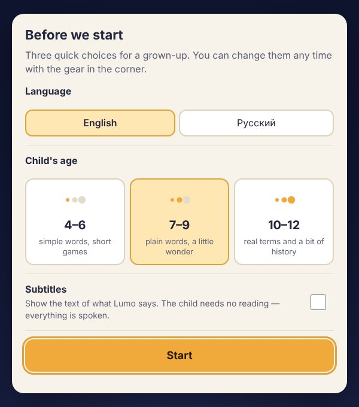

# Lumo — Sky of Questions

*Русская версия: [README.ru.md](README.ru.md)*

**Demo: [nemilya.me/projects/math](https://nemilya.me/projects/math/)**

Humane mathematics for children, inspired by Paul Lockhart's essay
**"A Mathematician's Lament"**.

> "Mathematics is the music of reason. To do mathematics is to engage in an act of discovery
> and conjecture, intuition and inspiration... to be overwhelmed by an almost painful beauty;
> to be *alive*." — Paul Lockhart

There are no lessons, points, levels or "right/wrong" here. There is a night sky where every
star is a question, and a small light called **Lumo**, the keeper of questions, who plays along
with the child. Everything is explained **by voice** — the child doesn't need to read. And the
main thing the child does is find an idea with their hands and **explain it in their own words,
in their own voice**.

*Screenshots with subtitles switched on, so you can see what Lumo says. For a child, everything is spoken.*

| | |
|---|---|
|  |  |
| **The sky of questions.** Big stars are adventures, violet ones are open questions, nebulae hold what is still being built, the green "+" is the child's own question. A star leads to new ones: the triangle opens the pyramid. | **Triangle in a box.** How much of the box does it take up? Guess → play → one "magic cut" → each part is cut exactly in half → why the triangle is half. |
|  |  |
| **A pyramid in a cube** — the question Lockhart's essay ends with. Turn the glass cube, put the tip in a corner — three equal pyramids fill the cube, so each is a third. | **…wherever the tip is.** Sliced like a deck of cards, the pyramid only shifts its layers when the tip moves — so it is still a third. |
|  |  |
| **The corner in a semicircle.** The corner is always square — but why? One of Lockhart's students: turn the triangle half a turn — equal diagonals make a rectangle. | **The last pebble.** The rules shown with pictures as Lumo tells them; "?" shows them again. Lumo keeps winning — find his secret, then test it on a new rule. |

## Run it

Any static server will do (no build step, no dependencies):

```bash
make serve                # http://localhost:8000  (or: npm start, or python3 -m http.server -d web 8000)
```

Open it on a tablet or a computer and tap the sleeping Lumo to wake him up. Best in landscape,
with sound on. `make help` lists all commands.

## For grown-ups



* **First launch** — one short screen for a grown-up: language, the child's age, subtitles.
  Everything is preselected (browser language, 7–9, no subtitles), so "Start" alone is fine.
  It is shown once; afterwards the same settings live behind the gear.
* **Language** — the EN / RU switcher in the top bar (as in the `education` project:
  `?lang=` → last choice → browser language → English; the choice goes into the address).
* **The gear** opens the grown-ups' panel — the only place with text to read:
  * **child's age** — 4–6, 7–9 or 10–12. Changes Lumo's words: simpler and shorter for little
    ones (and shorter games), real names (diagonal, parallelogram, multiples) and a bit of
    history (Thales, Euclid, where the triangle-area formula comes from) for older children;
  * **hints** — Lumo gives a gentle hint when the child is quiet for a while. Each hint is said
    once, then Lumo waits patiently. Can be switched off;
  * **subtitles**;
  * **"explain in their own words"** and the **discovery album** — see below;
  * **start over**.

### How the microphone works

At the end of an adventure Lumo invites the child to explain the idea out loud ("mathematics is
the art of explaining"). The recording is played straight back to the child — they hear their own
explanation — and kept **only in this browser** (IndexedDB) next to the star. It is never
uploaded and never analysed: Lumo doesn't "understand" what was said and doesn't grade it. The
feedback here is human: grown-ups listen in the **discovery album** and talk with the child.
Understanding the explanation and replying to it is on the [roadmap](docs/ROADMAP.md) (it needs
a server and parental consent). Where the browser gives no microphone, Lumo suggests telling it
to someone nearby — once — and stops offering.

## Voice

Lumo's voice is Gemini TTS via OpenRouter, the same approach as the `infographics` and
`education` projects. Every line — in every language and for every age — is its own MP3 in
`web/audio/<lang>/`, listed in `manifest.json`. The voiced files are committed; if a line has no
file yet, Lumo falls back to the browser's voice.

```bash
make voice                # synthesise new and changed lines (LANGS="ru" — one language)
```

Key: `OPENROUTER_API_KEY` in the environment, or a line `OPENROUTER_API_KEY = …` in `local.mk`
at the root (not in git); proxy — `OPENROUTER_PROXY`. Voice, model and manner — `voice.config.json`.
Files are named by a hash of text and voice: only changed lines are synthesised, unused files
are deleted. Every new clip is transcribed back and compared with the text. Needs `ffmpeg`.

## Hosting

```bash
make dist                 # → dist/ and dist.zip
```

Upload the contents of `dist/` to **any subfolder** of a static host (e.g. `example.org/lumo/`):
all paths are relative, no server code or database. `.js` must be served as JavaScript and
`.mp3` as audio/mpeg (the default for nginx and Apache).

For development: `?lang=ru` (language), `?fast` (no voice, fast, subtitles — for tests),
`?reset` (forget progress). Check the lines in every language and age: `make check`.

## Documents

* [**Vision**](docs/VISION.md) — the spirit of the book and the principles every adventure follows
* [**Lumo**](docs/KEEPER.md) — the character: personality, speech, states, ages, grammar of lines
* [**Architecture**](docs/ARCHITECTURE.md) — scenes, voice, languages, ages, data, hosting
* [**Writing an adventure**](docs/AUTHORING.md) — for authors: dramaturgy, template, checklist
* [**Roadmap**](docs/ROADMAP.md) — directions of growth and a bank of adventure ideas

## License

[MIT](LICENSE) — the code, the adventures, the lines and the generated voice clips. Use it, change it,
build your own adventures on it. The gear icon is from [Feather Icons](https://feathericons.com) (MIT).

## What's there already

* four adventures straight from the essay: a triangle in a box, a pyramid in a cube (in 3D — the question the essay ends with), the corner in a semicircle, the "last pebble" game;
* a sky of questions that grows: open questions appear after adventures;
* Lumo's voice — neural TTS for every line, English and Russian;
* three age bands: Lumo talks more simply with little ones and more precisely, with history, with older ones;
* hints only on silence — each once, can be switched off;
* explanations, ideas and the child's own questions recorded in their voice — on the device only, with an album for grown-ups;
* `make dist` — a ready folder for any host.
