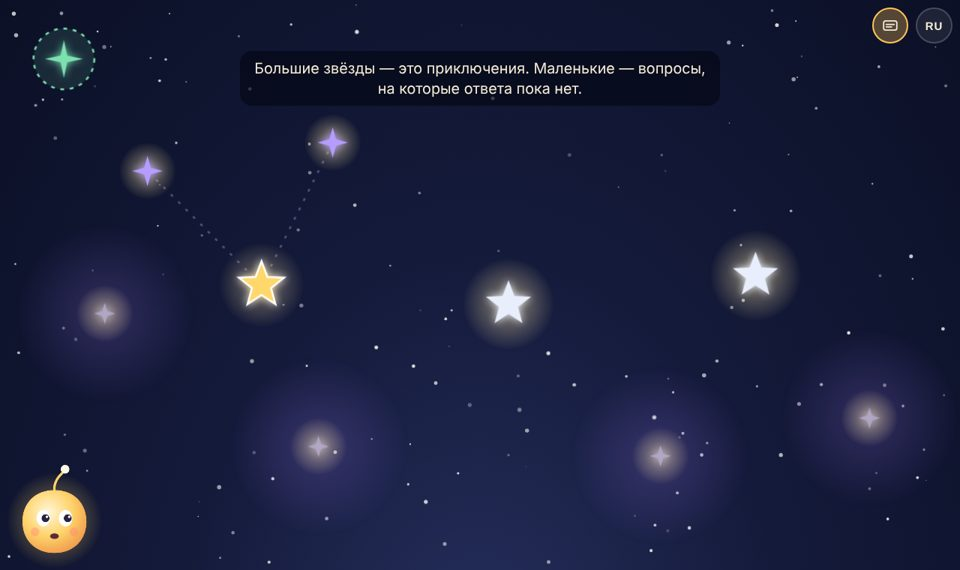
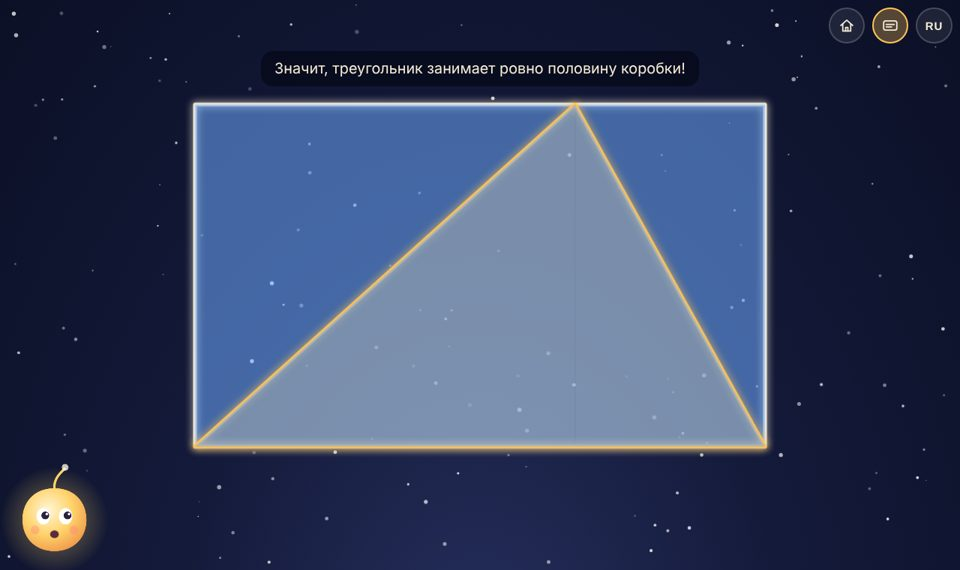
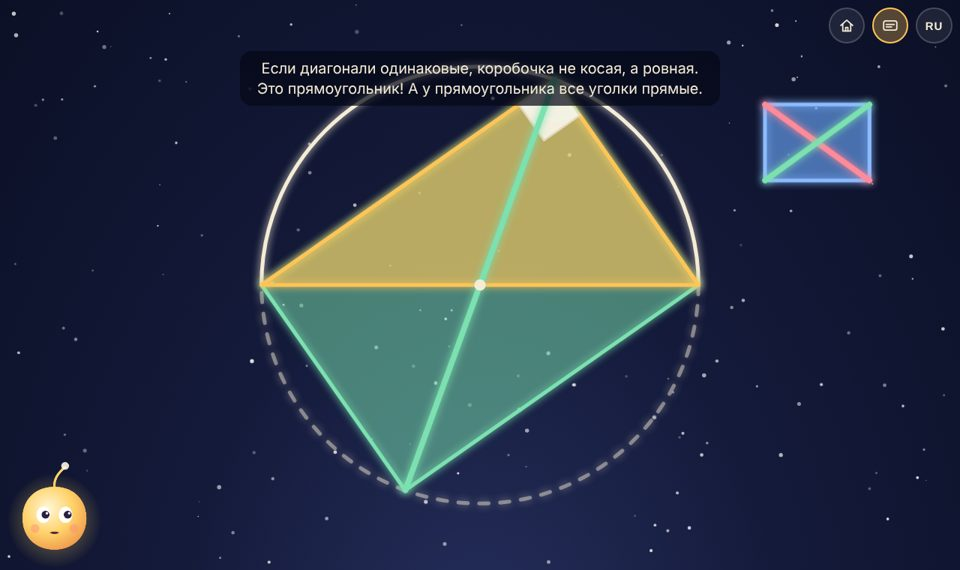
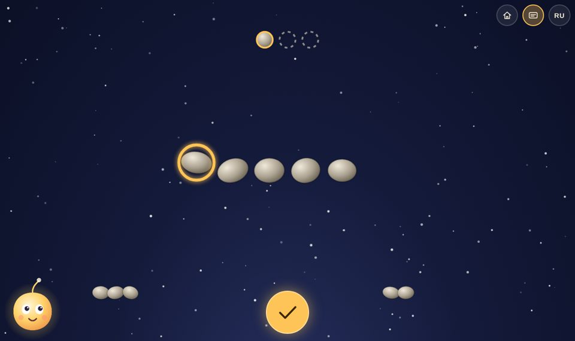

# Лумо — небо вопросов

*English version: [README.md](README.md) (основной язык проекта — английский)*

**Демо: [nemilya.me/projects/math](https://nemilya.me/projects/math/)**

Проект человечной математики для детей. По мотивам эссе Пола Локхарта
**«A Mathematician's Lament»** («Плач математика»).

> «Математика — это музыка разума... Делать математику — значит открывать и
> догадываться, вдохновляться и путаться, быть ошеломлённым почти болезненной
> красотой. Быть *живым*». — Пол Локхарт

Здесь нет уроков, баллов, уровней и «правильно/неправильно». Есть ночное небо,
где каждая звезда — вопрос, и маленький огонёк **Лумо**, хранитель вопросов,
который играет вместе с ребёнком. Всё объясняется **голосом** — ребёнку не нужно
уметь читать. А главное, что ребёнок делает, — находит идею руками и **объясняет её
своими словами, своим голосом**.

| | |
|---|---|
|  |  |
| **Небо вопросов.** Большие звёзды — приключения, фиолетовые — открытые вопросы, туманности — то, что ещё строится, зелёный «+» — свой вопрос ребёнка. | **Треугольник в коробке.** Сколько места он занимает? Догадка → игра → один «волшебный разрез» → почему ровно половина. |
|  |  |
| **Уголок в полукруге.** Уголок всегда прямой — но почему? Идея ученика Локхарта: повернуть треугольник на пол-оборота. | **Последний камешек.** Игра, в которой Лумо всё время выигрывает. Найди его секрет — и проверь его на новом правиле. |

## Запуск

Нужен любой статический сервер (сборки и зависимостей нет):

```bash
make serve                # http://localhost:8000  (или: npm start, или python3 -m http.server -d web 8000)
```

Откройте на планшете или компьютере, нажмите на спящего Лумо — и он проснётся.
Лучше всего — в альбомной ориентации и со звуком. `make help` — все команды.

## Для взрослых

* **Первый запуск** — один короткий экран для взрослого: язык, возраст ребёнка, субтитры.
  Всё уже выбрано по умолчанию (язык браузера, 7–9 лет, без субтитров) — можно сразу нажать
  «Начать». Показывается один раз, дальше те же настройки — за шестерёнкой.
* **Язык** — переключатель EN / RU вверху справа (как в проекте `education`:
  `?lang=` → последний выбор → язык браузера → английский; выбор попадает в адрес).
* **Шестерёнка** открывает панель для взрослых — единственное место с текстом:
  * **возраст ребёнка** — 4–6, 7–9 или 10–12 лет. Меняет слова Лумо: малышам — проще и
    короче (и игры короче), старшим — настоящие названия (диагональ, параллелограмм,
    кратные числа) и немного истории (Фалес, Евклид, откуда формула площади треугольника);
  * **подсказки** — Лумо мягко подсказывает, если ребёнок долго молчит. Каждая подсказка
    звучит один раз, дальше Лумо терпеливо ждёт. Можно выключить совсем;
  * **субтитры**;
  * **«рассказать своими словами»** и **альбом открытий** — см. ниже;
  * **начать сначала**.

### Как работает микрофон

В конце приключения Лумо предлагает объяснить идею вслух («математика — это искусство
объяснять»). Запись сразу проигрывается ребёнку — он слышит своё объяснение — и
сохраняется **только в этом браузере** (IndexedDB) рядом со звездой. Никуда не
отправляется и ничем не анализируется: Лумо не «понимает» сказанное и не оценивает его.
Обратная связь здесь — живая: взрослые слушают записи в **альбоме открытий** и
разговаривают с ребёнком. Распознавание и ответы Лумо по смыслу — в дорожной карте
(это потребует сервера и отдельного согласия родителей). Микрофон можно выключить в
настройках; где браузер его не даёт, Лумо предлагает рассказать идею кому-нибудь рядом.

## Озвучка

Голос Лумо — Gemini TTS через OpenRouter, как в проектах `infographics` и `education`.
Каждая реплика (на каждом языке и для каждого возраста) — отдельный mp3 в
`web/audio/<язык>/`, список — в `manifest.json`. Готовая озвучка лежит в git; если файла
для реплики нет, Лумо говорит голосом браузера.

```bash
make voice                # синтез новых и изменённых реплик (LANGS="ru" — один язык)
```

Ключ — `OPENROUTER_API_KEY` в окружении или строка `OPENROUTER_API_KEY = …` в `local.mk`
в корне (не в git); прокси — `OPENROUTER_PROXY`. Голос, модель и манера — `voice.config.json`.
Файлы названы по хешу текста и голоса: синтезируются только изменённые реплики, лишние
удаляются. Каждая новая реплика распознаётся обратно и сверяется с текстом. Нужен `ffmpeg`.

## Разместить на хостинге

```bash
make dist                 # → dist/ и dist.zip
```

Содержимое `dist/` залить в **любую подпапку** статического хостинга (например
`example.ru/lumo/`): все пути относительные, сервера и базы не нужно. `.js` должен
отдаваться как JavaScript, `.mp3` — как audio/mpeg (поведение по умолчанию у nginx и Apache).

Для разработки: `?lang=ru` (язык), `?fast` (без голоса, быстро, с субтитрами — для тестов),
`?reset` (забыть прогресс). Проверка реплик на всех языках и возрастах: `make check`.

## Документы

* [**Видение**](docs/ru/VISION.md) — дух книги и принципы, по которым делается каждое приключение
* [**Лумо**](docs/ru/KEEPER.md) — персонаж: характер, речь, состояния, грамматика реплик
* [**Архитектура**](docs/ru/ARCHITECTURE.md) — как устроены сцены, голос, языки, данные
* [**Как написать приключение**](docs/ru/AUTHORING.md) — для авторов: драматургия, шаблон, чек-лист
* [**Дорожная карта**](docs/ru/ROADMAP.md) — этапы роста и банк идей новых приключений

## Лицензия

[MIT](LICENSE) — код, приключения, реплики и сгенерированная озвучка. Можно использовать, менять и
делать на этой основе свои приключения. Иконка шестерёнки — из [Feather Icons](https://feathericons.com) (MIT).

## Что уже есть

* четыре приключения прямо из эссе: треугольник в коробке, пирамида в кубе (объёмная — вопрос, которым заканчивается эссе), уголок в полукруге, игра «последний камешек»;
* небо вопросов, которое растёт: после приключений на нём появляются открытые вопросы;
* голос Лумо — нейросинтез (Gemini TTS) для всех реплик, английский и русский;
* три возраста: Лумо говорит с малышами проще, со старшими — точнее и с историей;
* подсказки только при молчании — каждая один раз, можно выключить;
* запись объяснений, идей и собственных вопросов голосом ребёнка — только на устройстве, с альбомом для взрослых;
* `make dist` — готовая папка для любого хостинга.
